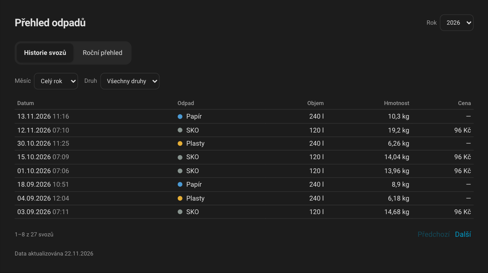
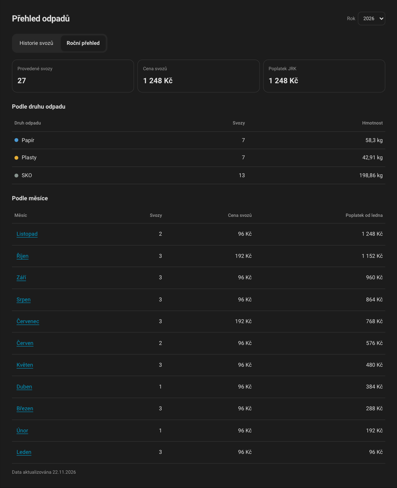

# JRK Digital pro Home Assistant

[](https://github.com/CooLajz/ha-jrk-digital/actions/workflows/validate.yml?query=branch%3Amain)

Kolikrát se letos vyvážela nádoba na směsný odpad a kolik už svozy stály? Integrace načte evidenci z občanského portálu JRK Digital. Každé vybrané svozové místo má v Home Assistantu vlastní zařízení, kalendáře, senzory a měsíční statistiky. Součástí je také karta **JRK Digital · Přehled odpadů**.



## Instalace

Potřebujete **Home Assistant 2026.11.0 nebo novější** a účet s přístupem ke svozovému místu v [občanském portálu JRK Digital](https://app-cp.jrkdigital.eu/). Jde o komunitní integraci, která používá stejné přihlášení a data jako webový portál.

<!-- ha-marketplace:exclude-start -->
1. [Otevřete repozitář v Marketplace](https://my.home-assistant.io/redirect/marketplace_repository/?owner=CooLajz&repository=ha-jrk-digital&category=integration). Můžete jej také přidat přes **Nastavení → Marketplace → Přidat z odkazu** pomocí adresy `https://github.com/CooLajz/ha-jrk-digital`.
2. Pokud Vás Marketplace vyzve, propojte jej s GitHubem. Zvolte kategorii **Integrace** a nainstalujte **JRK Digital**.
<!-- ha-marketplace:exclude-end -->

V **Nastavení → Zařízení a služby → Přidat integraci** vyhledejte **JRK Digital** a zadejte své údaje pro občanský portál. Můžete také [otevřít průvodce přidáním integrace](https://my.home-assistant.io/redirect/config_flow_start/?domain=jrk_digital). Pokud obec spravuje přes Váš účet více míst, vyberte ta, která chcete sledovat. Jediné dostupné místo se přidá automaticky.

Výběr můžete kdykoli změnit v nabídce **⋮** u přidaného účtu JRK Digital volbou pro změnu konfigurace. Již sledovaná místa jsou předem zaškrtnutá. U nově přidaného místa se načte jeho historie. Po změně hesla postupujte podle výzvy Home Assistantu k opětovnému přihlášení.

## Co uvidíte

| Kde | Údaje |
| --- | --- |
| Kalendář **Plán svozů** | Budoucí celodenní termíny zveřejněné portálem pro dané místo. |
| Kalendář **Historie svozů** | Evidované svozy s místním časem, nádobou a dostupnými údaji o hmotnosti, objemu a ceně. |
| Senzory místa | Příští a poslední svoz, cena posledního placeného svozu, měsíční cena a počet svozů, počet placených svozů a roční hmotnost podle druhů odpadu. |
| Senzor **Průběžný roční poplatek** | Částka vykázaná portálem od začátku roku. Atribut `pocet_placenych_svozu` obsahuje počet svozů s kladnou cenou v daném roce. |
| Dlouhodobé statistiky | Měsíční počty celkem, placené a bez poplatku, počty plastů, papíru a směsného odpadu a cena svozů. |

**Směsný komunální odpad (SKO)** může mít v historii datum, hmotnost i cenu, přestože jeho příští termín v plánu chybí. Kalendář přebírá plán konkrétního místa z portálu. Pokud JRK termín nezveřejní, v kalendáři se neobjeví.

## Karta na dashboard

V režimu úprav přehledu zvolte **Přidat kartu**, vyhledejte **JRK Digital · Přehled odpadů** a vyberte svozové místo. Karta se načítá společně s integrací. Pokud jste měli přehled otevřený během instalace, obnovte stránku.

- **Historie svozů** zobrazuje jednotlivé záznamy. Vyberte rok, měsíc nebo druh odpadu. V editoru můžete omezit počet posledních dní či záznamů, nastavit počet řádků na stránku a zapnout stránkování.
- **Roční přehled** shrnuje počet svozů, cenu a průběžný poplatek. Pod souhrnem najdete rozpis podle druhů odpadu a měsíců. **Cena svozů** patří ke konkrétnímu měsíci, **Poplatek od ledna** je kumulativní. Kliknutím na měsíc otevřete příslušné svozy, pokud je zapnutý přepínač pohledů.
- **Zobrazení na tabletu** můžete zjednodušit skrytím nadpisu, svozového místa, filtrů nebo jednotlivých sloupců. Objem je v litrech a čas svozu se zobrazuje v místním čase včetně přechodu na letní čas. Pomlčka znamená, že příslušný údaj u záznamu chybí.



### Kompaktní historie na pět řádků

V příkladech nahraďte identifikátor kalendáře entitou svého místa. Pro **historii** vyberte kalendář historie, pro **plán** kalendář plánu.

```yaml
type: custom:jrk-waste-card
entity: calendar.vase_misto_historie_svozu
view: history
page_size: 5
pagination: false
compact: true
show_place: false
show_updated: true
```

### Plán svozů v TrashCard

Nainstalujte si samostatnou kartu [TrashCard](https://github.com/idaho/hassio-trash-card). Vyberte kalendář plánu a podle názvů událostí svého místa nastavte vzory, barvy a ikony. Pro začátek můžete zobrazit i události bez vlastního vzoru.

```yaml
type: custom:trash-card
entities:
  - calendar.vase_misto_plan_svozu
next_days: 60
filter_events: false
pattern:
  - type: paper
    pattern: Papír
    label: Papír
    icon: mdi:newspaper
    color: blue
  - type: recycle
    pattern: Plast
    label: Plasty
    icon: mdi:recycle
    color: amber
```

### Graf počtu svozů nebo ceny

Přidejte vestavěnou kartu **Graf statistik**, zvolte období **měsíc** a statistiku **změna**. Vyhledejte název svého místa a přidejte například **Počet svozů – Plasty**, **Počet svozů – Papír** a **Počet svozů – SKO**. Pro rozdělení podle ceny vyberte **Počet placených svozů** a **Počet svozů bez poplatku**. Do samostatného grafu v měně místa přidejte **Cena placených svozů**.

## Aktualizace a historie

Při prvním připojení se načtou dostupná vykazovací období. Poté integrace jednou denně kontroluje poslední rok a zapracuje i zpětné opravy. Po delší odstávce doplní zmeškané období. Starší záznamy uchovává v Home Assistantu. Poplatek se přebírá z vyúčtování JRK, cena se ke svozu přiřazuje podle identifikátoru záznamu. Pro statistiky počtu svozů je rozhodující místní datum skutečného svozu.

Po restartu může integrace ihned zobrazit uloženou historii a poslední známý plán. Pokud je potřeba data obnovit a portál je dočasně nedostupný, karta ukáže datum uložených údajů. Integrace opakuje pokus po 15 minutách. Po úspěšné synchronizaci se otevřená karta přepočítá i při zpětné opravě ceny.

Při potížích můžete [založit hlášení na GitHubu](https://github.com/CooLajz/ha-jrk-digital/issues). Uveďte verzi Home Assistantu, verzi integrace a krok, při kterém problém nastal. Z přiložených výpisů a snímků odstraňte přihlašovací údaje, adresu a identifikátory svozového místa.
